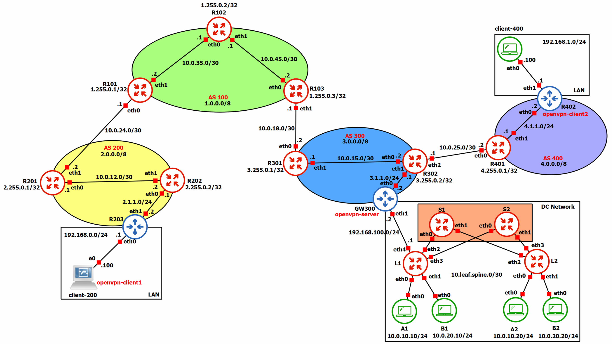

# Network and System Defence — Secure Multi-AS Network Lab

## Overview

Academic project developed for the *Network and System Defence* course at the University of Rome Tor Vergata. The project focuses on the design, configuration and testing of a simulated multi-AS network infrastructure using GNS3, integrating inter-domain routing, Data Center networking, secure connectivity and network security mechanisms.

The lab combines routing protocols, network virtualization and traffic filtering to model communication across multiple autonomous systems and internal networks.

## Network Topology

The simulated infrastructure comprises multiple interconnected Autonomous Systems and a Data Center network based on the spine-leaf architecture.

## Key Features

- **Inter-domain and intra-domain routing:** configuration of BGP for routing between Autonomous Systems (ASes) and OSPF for internal routing.
- **MPLS:** implementation of MPLS forwarding and Label Distribution Protocol (LDP) within AS 100.
- **Data Center networking:** design of a spine-leaf topology using Cumulus Linux, with BGP EVPN, VXLAN overlays, VLAN segmentation and VRF configuration.
- **VPN connectivity:** deployment of an OpenVPN server and clients, certificate-based authentication and routing to remote networks.
- **Firewall and network traffic control:** implementation of packet-filtering rules, stateful forwarding, IP forwarding and Network Address Translation (NAT) using `iptables`.
- **Host security:** configuration of an AppArmor profile to demonstrate application-level access restrictions.
- **Network validation:** verification of routing information and end-to-end connectivity between nodes across different network segments.

## Technologies

`GNS3` · `Linux` · `FRRouting` · `BGP` · `OSPF` · `MPLS/LDP` · `EVPN/VXLAN` · `VLAN/VRF` · `OpenVPN` · `iptables` · `AppArmor`

## Repository Contents

- **[GNS3 project](project1-0338469.gns3project):** network simulation project.
- **[Project specification](Project%20specification.pdf):** assignment brief defining the project requirements.
- **[Detailed configuration guide](Report%20Network%20And%20System%20Defence%20-%20Project%201.pdf):** technical report describing the project, routing configuration, Data Center setup, VPN deployment and security rules.

## Getting Started

Open or import the GNS3 project using GNS3 and ensure that the required node images and software are available. Refer to the detailed configuration guide for the network setup and configuration commands.
